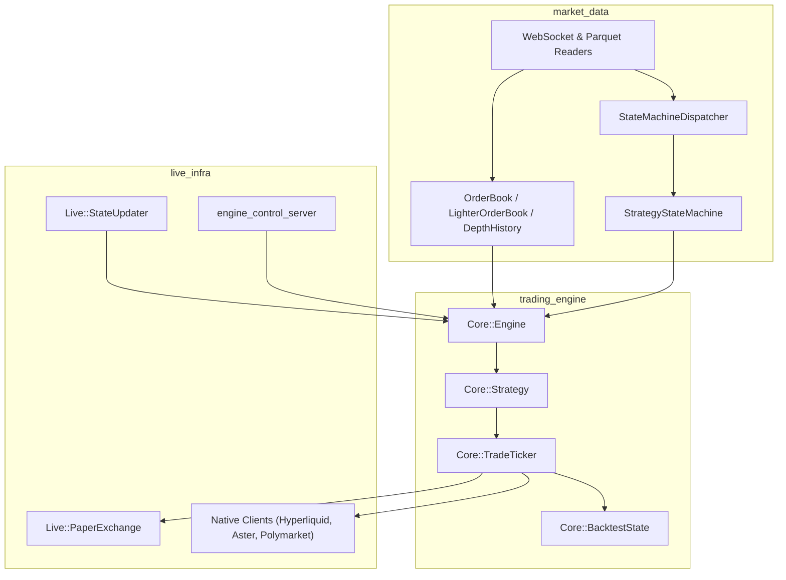

# Architecture

KeronisEngine splits the system into three layers: market data and feature state machines (`market_data`), core order/trade/risk state (`trading_engine`), and venue/simulation adapters (`live_infra` and `BacktestState`).



## Core components

### `Core::Engine`, `Core::Strategy`, and `Core::TradeTicker`

- `Core::Engine` is a process-wide singleton holding active strategies, order books, price/BBA caches, account inventory, exchange symbol precision rules, and the active clock (simulation time in backtests, wall-clock time in live runs). Using a singleton keeps hot-path callbacks lightweight and matches the one-process-per-host live deployment model; unit tests reset state explicitly between cases.
- `Core::Strategy` holds `StrategyConfig`, exposure and order-rate limits, virtual balance, pause state (`stop_making_markets`), quote-pull state (`quotes_pulled`), and a map of `TradeTicker` instances by symbol.
- `Core::TradeTicker` tracks open orders, recently removed orders (retained for late-fill matching), and open `Trade` records. All order submissions go through `construct_order()`, which enforces risk caps, rate limits, reduce-only constraints, and quote-pull gates before returning a valid `Order`.
- Headers for `trading_engine` live under `include/market_making/` for historical continuity.

### `RingBufferBook`

Order books in `trading_engine/include/market_making/dtypes/ring_buffer_book.h` use a fixed-size flat array indexed by `tick_idx & mask` rather than `std::map`:

- Each slot is a 16-byte POD (`uint32_t tick_tag`, `uint32_t updated_sec`, `double qty`). `tick_tag == 0` marks an empty slot; a tag mismatch rejects stale wrapped entries.
- A 64-bit occupancy bitmap tracks populated slots so depth walks (`get_bid_depth`, `get_ask_depth`) skip empty ranges with `__builtin_ctzll`.
- Slot arrays are allocated via `std::make_unique_for_overwrite<RingPriceLevel[]>(N)` so untouched anonymous `mmap` pages consume no physical RAM until written.
- Window size is set at runtime via `window_bits`: 19 bits (524K slots, 16 MB virtual) for exchange books, 10 bits (1024 slots, ~32 KB) for Polymarket.
- Single-threaded `apply_bid` benchmarks at ~1.5 ns/op on an Intel Core Ultra 9 285K compiled with `-O3 -fno-fast-math -ffp-contract=off -frounding-math`.

### Market data and Parquet layout

`backtest_runner` and `historical_feature_gen` read partitioned Arrow/Parquet datasets rooted at `DATA_DIR_ROOT`. OHLCV bars follow:

```text
<DATA_DIR_ROOT>/derived/bars/<exchange>/<market_type>/time/<interval_ms>_ms/<SYMBOL>/parquets/year=YYYY/month=MM/day=DD/YYYY-MM-DD.parquet
```

Required OHLCV columns (`ohlcv_dataset_tick.cpp`): `kline_open_time_ms` (int64), `kline_close_time_ms` (int64), `open_price`, `high_price`, `low_price`, `close_price`, `volume`, `quote_asset_volume` (float64), `number_of_trades` (int64), `taker_buy_base_volume`, and `taker_buy_quote_volume` (float64).

### Execution simulation: `BacktestState` vs `PaperExchange`

Strategies and state machines are shared across backtest, paper, and live runs, while fill simulation is handled by two separate components:

- **`BacktestState` (`trading_engine`):** Deterministic event-loop replay over Parquet bars, trades, and order-book updates. Models order latency, maker/taker fees, swap leverage, and Polymarket queue-position notional (`order_queue_notional_accumulated`).
- **`PaperExchange` (`live_infra`):** Runs on a dedicated thread inside `live_infra` for paper accounts/strategies. Each order is first evaluated as a taker at `ack + latency` against recorded/live depth; any resting remainder is evaluated as a maker against resting quotes and subsequent trade prints. Canceling an order stops later prints from filling it.

### Numeric determinism

- All C++ targets compile with `-fno-fast-math -fno-strict-aliasing -ffp-contract=off -frounding-math`.
- Order quantities, fees, and realized PnL use `mpfr::mpreal` (`common/include/mpreal.h`), a clean-room Apache-2.0 wrapper over dynamically linked MPFR/GMP arbitrary-precision binary floating point.
