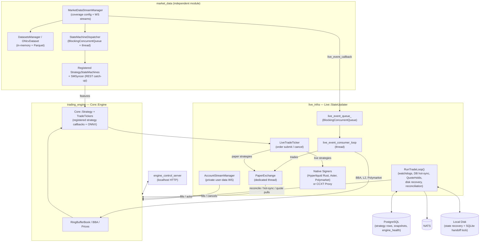
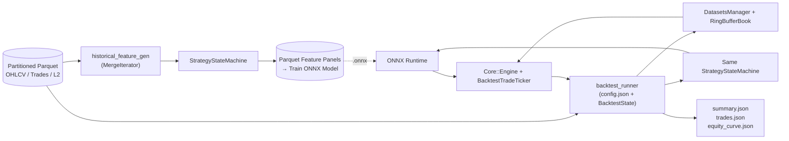

# Architecture

KeronisEngine is built as independent C++20 modules wired together at process startup. `trading_engine` has no dependency on live exchanges, PostgreSQL, or WebSockets; `market_data` can run inside `live_infra` or standalone; and `backtest_runner` and `historical_feature_gen` run completely offline against Parquet files.

## Module boundaries

| Module | What it owns | What it does not touch |
|---|---|---|
| `market_data` | `MarketDataStreamManager`, `MarketDataStreams`, `OhlcvDataset` / `DatasetsManager`, `LighterOrderBook`, `DepthHistory`, `StrategyStateMachine`, `StateMachineDispatcher`, `SMSyncer` | Orders, positions, accounts, venue execution |
| `trading_engine` | `Core::Engine`, `Core::Strategy`, `Core::TradeTicker` (base), `RingBufferBook`, risk/rate limits, `BacktestState`, `BacktestTradeTicker` | Live sockets, venue signing, PostgreSQL, NATS |
| `live_infra` | `Live::StateUpdater`, `Live::LiveTradeTicker`, `Live::AccountStreamManager`, `Live::PaperExchange`, `QuoteHolds`, native venue clients, standby handoff | Backtest replay |
| `backtest_runner` | CLI entry point that parses `config.json`, drives `Core::BacktestState`, and dumps `summary.json`, `trades.json`, `equity_curve.json` | PostgreSQL, NATS, live venues |
| `historical_feature_gen` | `MergeIterator` + Parquet writer that replays historical data through any registered `StrategyStateMachine` | Orders, strategies, live venues |
| `engine_control_server` | Embedded localhost HTTP server (`cpp-httplib`) reading/mutating `Core::Engine` | Venue I/O |

The seam between core trading logic and execution is `Core::TradeTicker`: in `live_infra` each symbol uses `Live::LiveTradeTicker` (which routes orders through `Live::StateUpdater`), and in `backtest_runner` each symbol uses `Core::BacktestTradeTicker` (which routes orders into `Core::BacktestState`).

---

## Live runtime (`live_infra`)

In live and paper deployments, `Live::StateUpdater` is the process orchestrator (`RunTradeLoop()`).



### How the live process starts and hands off

`live_infra` is designed for cron-managed zero-downtime restarts:

1. **Startup & standby check (`main.cpp`):** Checks `program_start_time.db` and `heartbeat_cache.db` (SQLite). If an active instance has a fresh heartbeat and more than one cron interval left before `program_end_time`, the new standby exits immediately so a fresher standby inherits later.
2. **Warmup before lock (`StateUpdater`):** Starts `MarketDataStreamManager` (building in-memory OHLCV datasets and opening public WebSockets), starts `live_event_consumer_loop()` and `liveness_heartbeat_loop()`, initializes accounts and direct-signing clients, fetches prices and exchange info at low process priority.
3. **Lock acquisition & recovery (`RunTradeLoop`):** Acquires `/tmp/live_infra_state_lock`, checks free disk space, runs `recover_state_from_disk()` to restore open orders and trades, calls `Core::Engine::state_is_ready()`, and starts `PaperExchange`.
4. **Main control loop:** On each tick, bumps `last_main_loop_tick_ms_` (watched by the dead-man's-switch liveness thread) and runs periodic tasks:
   - `poll_strategy_rows()`: diffs PostgreSQL `strategy` / `trade_ticker` rows by fingerprint and hot-adds or updates strategies without restarting, carrying over `virtual_balance`, `stop_making_markets`, and `quotes_pulled`.
   - `poll_quote_holds()`: checks durable quote-pull state and (when `IS_PROD=1`) `quote_guard` heartbeat freshness in `engine_health`.
   - `poll_order_state_watchdog()`, `poll_inventory_state_watchdog()`, `poll_check_unacked_orders()`, `poll_check_failed_cancels()`, `poll_stall_orders_watchdog()`: reconciles local engine state against venue REST state alongside the real-time `AccountStreamManager` streams.
   - `poll_sync_state_to_disk()` and `write_db_entries_from_engine_snapshot()`: persists state to disk and PostgreSQL and publishes events to NATS.
5. **Graceful shutdown:** On `SIGTERM` (or when `PROGRAM_MAX_RUNTIME_MINUTES` elapses), `StateUpdater` pulls resting entry quotes (`QuotesPullReason::SHUTDOWN`), flushes state, and releases the file lock so the waiting standby takes over.

---

## Offline pipeline (`historical_feature_gen` & `backtest_runner`)

Neither offline binary uses `live_infra`, PostgreSQL, or NATS. Both read partitioned Parquet files under `DATA_DIR_ROOT` and link the same `StrategyStateMachine` and `Core::Strategy` registries.



### Parquet bar layout

OHLCV bar datasets live under:

```text
<DATA_DIR_ROOT>/derived/bars/<exchange>/<market_type>/time/<interval_ms>_ms/<SYMBOL>/parquets/year=YYYY/month=MM/day=DD/YYYY-MM-DD.parquet
```

Required columns (`ohlcv_dataset_tick.cpp`): `kline_open_time_ms` (int64), `kline_close_time_ms` (int64), `open_price`, `high_price`, `low_price`, `close_price`, `volume`, `quote_asset_volume` (float64), `number_of_trades` (int64), `taker_buy_base_volume`, `taker_buy_quote_volume` (float64).

---

## Key internals

### `RingBufferBook`

Order books (`trading_engine/include/market_making/dtypes/ring_buffer_book.h`) use a flat tick-indexed array hashed by `tick_idx & mask` rather than `std::map`:

- 16-byte POD slots (`uint32_t tick_tag`, `uint32_t updated_sec`, `double qty`); `tick_tag == 0` means empty, and tag mismatch rejects stale wrapped slots.
- 64-bit occupancy bitmap so depth walks (`get_bid_depth`, `get_ask_depth`) skip empty ranges with `__builtin_ctzll`.
- Heap-allocated with `std::make_unique_for_overwrite<RingPriceLevel[]>(N)` so untouched `mmap` pages take zero physical RAM until written.
- Runtime `window_bits`: 19 bits (524K slots, 16 MB virtual) for exchange books, 10 bits (1024 slots, ~32 KB) for Polymarket.
- Single-threaded `apply_bid` benchmarks at ~1.5 ns/op on an Intel Core Ultra 9 285K (`-O3 -fno-fast-math -ffp-contract=off -frounding-math`).

### Fill simulation: `BacktestState` vs `PaperExchange`

- **`BacktestState`** replays recorded Parquet events in timestamp order with configurable latency, maker/taker fees, swap leverage, and Polymarket queue-position notional (`order_queue_notional_accumulated`).
- **`PaperExchange`** runs on its own thread inside `live_infra`. Each paper order is evaluated as a taker at `ack + latency` against live/recorded depth (with `PAPER_SLIPPAGE_BPS`, default `3`), and any resting remainder is evaluated as a maker against resting quotes and subsequent trade prints; canceling an order stops later prints from filling it.

### Numerics and singleton notes

- All C++ targets compile with `-fno-fast-math -fno-strict-aliasing -ffp-contract=off -frounding-math`.
- Order quantities, fees, and realized PnL use `mpfr::mpreal` (`common/include/mpreal.h`), a clean-room Apache-2.0 wrapper over dynamically linked MPFR/GMP arbitrary-precision binary floating point.
- `Core::Engine` is a process-wide singleton matching the one-process-per-host deployment model; unit tests reset state explicitly between cases.
- `trading_engine` headers live under `include/market_making/` for historical continuity.
