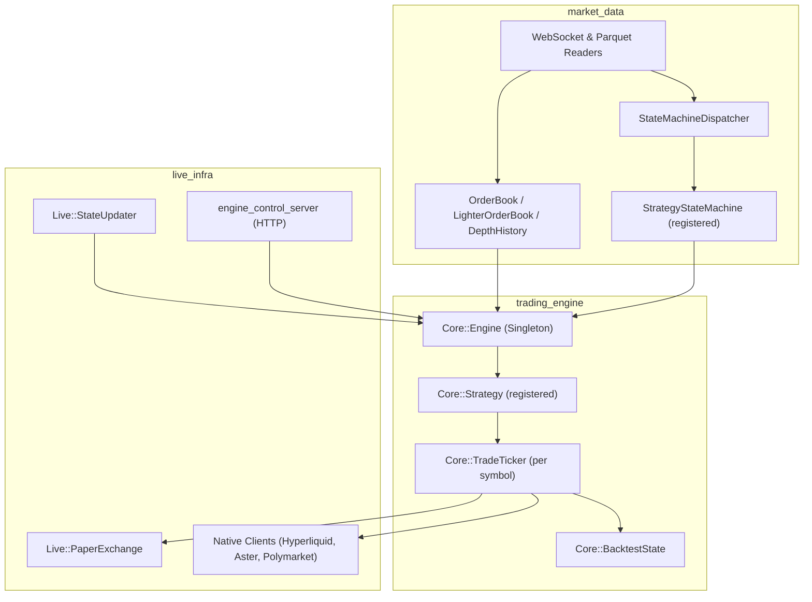

# Architecture

KeronisEngine separates **market data & feature computation**, **core strategy & order/risk state**, and **venue execution** so the same strategy binary runs identically in simulation and production.

## High-Level Components

## Package Breakdown

### `trading_engine`
- **`Core::Engine`**: Central coordinator owning active strategies, per-venue order books, BBA/price caches, inventory, exchange symbol metadata, and the simulation or wall-clock timer.
- **`Core::Strategy`**: Holds strategy configuration (`StrategyConfig`), risk caps, virtual balance, pause state (`stop_making_markets`), quote-pull state (`quotes_pulled`), and per-symbol `TradeTicker` instances.
- **`Core::TradeTicker`**: Manages open orders, removed/late-fill orders, open trades, and order construction (`construct_order`) with pre-trade risk and rate-limit validation.
- **`Core::BacktestState`**: Deterministic event-loop simulator reading Arrow/Parquet bars, trades, and order-book data, simulating latency, fees, leverage, and fills.
- **`Core::StrategyRegistry`**: Static self-registration table (`KERONIS_REGISTER_STRATEGY`). Binaries link `keronis_engine` with `WHOLE_ARCHIVE` so registered strategies are never stripped by the linker.

### `market_data`
- **`OhlcvDataset` & `DatasetsManager`**: Partitioned Arrow/Parquet bar storage (`parquets/year=*/month=*/day=*/<YYYY-MM-DD>.parquet`).
- **`StrategyStateMachine` & `StateMachineDispatcher`**: Streaming feature engines that update on every trade/bar/book event and expose point-in-time feature vectors to strategies and ONNX models.
- **`LighterOrderBook` & `DepthHistory`**: Nonce-validated L2 book maintenance and historical depth lookup (also used by `PaperExchange`).

### `live_infra`
- **`Live::StateUpdater`**: Syncs strategies, accounts, exchange info, inventory snapshots, and open trades with PostgreSQL and venues, and enforces quote holds (`quote_holds.h`) and graceful `SIGTERM` shutdown.
- **`Live::PaperExchange`**: Dedicated paper-trading venue that evaluates paper orders against live/recorded market depth with configurable latency and slippage.
- **Native exchange clients**: Direct REST/WebSocket and order signing for Hyperliquid (via `src/rust/hyperliquid_signer`), Aster, and Polymarket.

### `historical_feature_gen`
- Replays historical datasets through any registered `StrategyStateMachine` using `MergeIterator` to emit Parquet training panels with guaranteed train/serve feature parity.

### `engine_control_server`
- Embedded HTTP server (`cpp-httplib`) exposing read-only engine introspection (`/control/health`, `/control/engine/orders`, `/control/engine/inventory`, etc.) and optional gated mutations.

## Numeric Determinism & Design Notes

- All targets compile with `-fno-fast-math -fno-strict-aliasing -ffp-contract=off -frounding-math`.
- Order quantities, prices, fees, and realized PnL use `mpfr::mpreal` (a clean-room Apache-2.0 wrapper in `src/cpp/packages/common/include/mpreal.h` over dynamically linked MPFR/GMP arbitrary-precision binary floating point).
- **`Core::Engine` singleton:** One engine instance per process keeps hot-path callbacks lightweight and matches the single-process-per-host live deployment model; unit tests reset state explicitly between cases.
- **Header layout:** Headers for the `trading_engine` package live under `include/market_making/` for historical continuity across all strategy and live callers.
