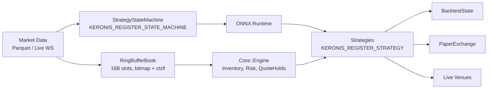

# KeronisEngine

KeronisEngine is an open-source C++20 trading engine with streaming feature state machines and in-process ONNX Runtime inference.

The same strategy functions and state machines run in offline feature generation (`historical_feature_gen`), historical event replay (`backtest_runner`), paper trading (`PaperExchange`), and live trading (`live_infra`). It is designed to ingest full-exchange crypto feeds (10,000+ messages/sec across Binance) while updating order books, computing features, and running ONNX inference on a single ~$100 dedicated server.

## Architecture overview

## Packages

| Package | Responsibility |
|---|---|
| `trading_engine` | `Core::Engine`, `Core::Strategy`, `Core::TradeTicker`, `RingBufferBook`, risk checks, `BacktestState` |
| `market_data` | Parquet OHLCV/trade readers, `LighterOrderBook`, `DepthHistory`, `StrategyStateMachine`, `StateMachineDispatcher` |
| `live_infra` | Live runtime (`live_infra`), `PaperExchange`, `QuoteHolds`, native clients for Hyperliquid, Aster, and Polymarket |
| `backtest_runner` | CLI runner that replays Parquet datasets from a `config.json` and writes `summary.json`, `trades.json`, `equity_curve.json` |
| `historical_feature_gen` | Runs registered state machines over historical Parquet data to emit training sets |
| `engine_control_server` | Embedded localhost HTTP server for inspecting live engine state |
| `strategies/` | Reference strategies: `sma_crossover`, `test_quoter`, `test_taker`, `test_market_maker`, `discretionary` |

## Supported venues

| Venue | Market data | Order execution | Notes |
|---|---|---|---|
| Hyperliquid | Native WebSocket | Native (Rust `hyperliquid_signer`) | Mainnet and testnet (`HYPERLIQUID_USE_TESTNET=1`) |
| Aster | Native WebSocket | Native | Mainnet and testnet (`ASTER_USE_TESTNET=1`) |
| Polymarket | Native CLOB WS | Native | Queue-notional fill tracking in `BacktestState` |
| Lighter | Native REST + L2 WS | `PaperExchange` | Nonce-checked `LighterOrderBook` and `DepthHistory` |
| Binance, Bybit, others | Native / Parquet | External proxy (`CCXT_PROXY_BASE_URL`) | External proxy is not included in this repo |

## Where to start

- [Quickstart](quickstart.md): build from source (or Docker), run unit tests, and run the `sma_crossover` backtest.
- [Architecture](architecture.md): `RingBufferBook` memory layout, `BacktestState` vs `PaperExchange` fill models, and numeric determinism.
- [Strategies](strategies.md): writing and registering external strategies with `-DKERONIS_STRATEGY_DIRS`.
- [State Machines & ONNX](state-machines.md): implementing `StrategyStateMachine` and running ONNX inference.
- [Live & Paper Trading](live-and-paper.md): PostgreSQL + NATS setup, `schema.sql`, `PaperExchange`, and `QuoteHolds`.
- [Comparison](comparison.md): tradeoffs against NautilusTrader and HftBacktest.

Plain Markdown documentation for scripts and agents is available at [`/llms.txt`](https://engine.keronis.ai/llms.txt) and [`/llms-full.txt`](https://engine.keronis.ai/llms-full.txt).

!!! warning "Disclaimer"
    KeronisEngine is licensed under Apache-2.0 and provided as-is without warranty. Validate strategies in `backtest_runner` and `PaperExchange` before running with live exchange credentials.
