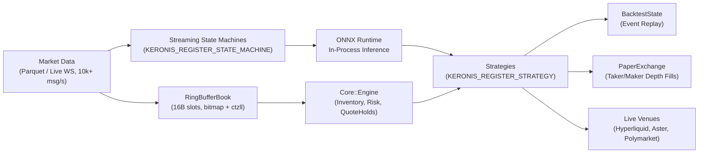

# KeronisEngine

**Process all of Binance's live market data — 10,000+ messages/sec with continuous streaming state-machine features and in-process ONNX predictions — on a single ~$100 dedicated server.**

KeronisEngine is an open-source C++20 trading engine designed for zero train/serve feature skew. Your strategy functions, streaming state machines, and ONNX models run across offline Parquet feature generation (`historical_feature_gen`), event-driven backtesting (`backtest_runner`), depth-based paper trading (`PaperExchange`), and live venue execution (`live_infra`).

[Get Started](quickstart.md){ .md-button .md-button--primary }
[Architecture](architecture.md){ .md-button }
[Comparison](comparison.md){ .md-button }
[GitHub Repo](https://github.com/JNeuvonen/keronisengine){ .md-button }

---

## Core Dataflow



## What Makes It Different

- **Built for full-exchange throughput on commodity hardware:** `RingBufferBook` uses flat tick-indexed 16-byte POD slots, an occupancy bitmap with `__builtin_ctzll` depth walks, and lazy OS page commitment—benchmarking at **~1.5 ns/op** for `apply_bid` on an Intel Core Ultra 9 285K under strict IEEE-754 flags (`-fno-fast-math -ffp-contract=off -frounding-math`).
- **Zero train/serve feature skew:** Write a streaming `StrategyStateMachine` once in C++20; run it in `historical_feature_gen` to emit Parquet training panels, then run the exact same machine in `backtest_runner` and `live_infra` feeding in-process ONNX Runtime inference.
- **Realistic execution & crash-safe live controls:** `PaperExchange` judges orders as taker at `ack + latency` and fills resting remainders against quotes and subsequent prints; `BacktestState` tracks Polymarket queue-position notional; and `QuoteHolds` persists quote pulls across engine restarts with a `quote_guard` staleness heartbeat.
- **Zero-fork extensibility:** Register external strategies and state machines with `-DKERONIS_STRATEGY_DIRS=...`—the engine never needs editing.
- **High-precision MPFR arithmetic:** Order quantities, fees, and realized PnL use a clean-room Apache-2.0 `mpreal` wrapper over dynamically linked MPFR/GMP.

## Supported Venues

| Venue | Market Data | Order Execution | Notes |
|---|---|---|---|
| **Hyperliquid** | Native WebSocket | Native (Rust signer) | Mainnet & testnet (`HYPERLIQUID_USE_TESTNET=1`) |
| **Aster** | Native WebSocket | Native | Mainnet & testnet (`ASTER_USE_TESTNET=1`) |
| **Polymarket** | Native CLOB WS | Native | Queue-position notional modeling in `BacktestState` |
| **Lighter** | Native REST + L2 WS | `PaperExchange` | Nonce-validated `LighterOrderBook` & `DepthHistory` |
| **Binance / Bybit / Others** | Native / Parquet | External proxy (`CCXT_PROXY_BASE_URL`) | Proxy not bundled in this repo |

## 60-Second Quickstart

```bash
docker run --rm ghcr.io/jneuvonen/keronisengine:latest \
  ./examples/quickstart_backtest/run.sh /src/build/bin/backtest_runner
```

!!! warning "Risk Disclaimer"
    KeronisEngine is Apache-2.0 licensed software provided **as-is** with no warranty. Always validate strategies in `backtest_runner` and `PaperExchange` before connecting live exchange credentials.
